# SMART TRADER BOT — SYSTEM ARCHITECTURE MAP

**Audit Date:** 2026-11-01 14:00 UTC  
**Phase:** 0 — Baseline & Scope Freeze  
**Target Symbol:** XAUUSD Intraday (ICT / Smart Money Concepts)  
**Broker Environment:** FundingPips $5,000 2-Step Flex (MT5)  

---

## 1. Executive Summary & Architecture Topology

Smart Trader Bot is architected as an institutional-grade, hybrid Python-MQL5 algorithmic trading system. The system strictly separates analytical intelligence, risk governance, and physical trade execution across three asynchronous tiers:

1. **Analytical Core (Python / AsyncIO):** Multi-timeframe market data ingestion, ICT/SMC structural detection (Model A & Model B), high-impact macroeconomic news filtering, and multi-tier institutional risk validation.
2. **Execution Bridge (FastAPI / HTTP WebRequest):** Local/VPS REST server acting as an isolated, stateful middleware between Python signal generation and the MT5 broker terminal. Enforces broker specification validation, lot sizing bounds, and emergency safety circuit breakers.
3. **Institutional Expert Advisor (MQL5 / MetaTrader 5):** `SmartTraderBridge.mq5` running directly on the MT5 terminal client chart. It polls the Bridge server via HTTP `WebRequest`, validates broker-side tick values and margins, transmits market/limit orders via `Trade\Trade.mqh`, executes microsecond-level breakeven adjustments at 1.0R, and enforces End-of-Day (EOD) flat closures before bank rollover.

---

## 2. Mermaid Architecture Diagram

```mermaid
flowchart TD
    subgraph Market_Data_Tier["1. Market Data Ingestion & Bias"]
        A1["FundingPips MT5 / Broker Candles"] -->|"Closed Bars (M5, M15, H1, D1)"| A2["DataFetcher (market/data_fetcher.py)"]
        A2 -->|"OHLCV DataFrames"| A3["TechnicalIndicators (market/indicators.py)"]
        A3 -->|"ATR, Swings, Pivots"| A4["Market Bias Determination\n(D1 Trend + H1 Equilibrium / Dealing Range)"]
    end

    subgraph Strategy_Tier["2. Strategy & Signal Generation"]
        A4 --> B1["ICTSMCStrategy.analyze()\n(strategies/ict_smc.py)"]
        B1 --> B2{"Entry Model Trigger"}
        B2 -->|"Sweep + MSS + FVG"| B3["Model A: Sweep MSS FVG"]
        B2 -->|"Trend + Discount/Premium + OB"| B4["Model B: Trend OB Pullback"]
        B3 --> B5["Candidate Signal Generated\n(Entry, SL, TP1, TP2, R:R >= 1:2.0)"]
        B4 --> B5
    end

    subgraph Institutional_Filters["3. Institutional Filter Pipeline"]
        B5 --> C1{"Smart Weekly Window\n(Mon 07:00 - Fri 14:00 UTC)"}
        C1 -->|Pass| C2{"IPDA Timing Bans\n(15:45-16:00 UTC & 17:00-00:00 UTC)"}
        C2 -->|Pass| C3{"Economic News Guard\n(+/-30m High Impact USD)"}
        C3 -->|Pass| C4{"Kill Zone Active\n(London 08:00-11:00 / NY 08:00-11:30)"}
        C4 -->|Pass| C5{"Max Daily Limits & Cooldown\n(Max 5-7/day, 1h Cooldown, Max 1 Pos)"}
        C5 -->|Pass| C6{"Minimum Structural SL Filter\n(SL >= $2.00 Gold)"}
        C6 -->|Pass| C7["MultiTFResult (4-5 Stars Validated)"]
        C1 -->|Block| REJ["Signal Rejected / Logged"]
        C2 -->|Block| REJ
        C3 -->|Block| REJ
        C4 -->|Block| REJ
        C5 -->|Block| REJ
        C6 -->|Block| REJ
    end

    subgraph Risk_Management_Tier["4. Risk Management & Position Sizing"]
        C7 --> D1["ExecutionBridge Risk Guard\n(trading/execution_bridge.py)"]
        D1 --> D2{"Daily Loss Lock\n(Drawdown >= 2.5% / $125)"}
        D2 -->|Breached| D_LOCK["Trading Halted / Autopilot Disabled"]
        D2 -->|Normal| D3{"Hard Equity Stop\n(Equity <= $4,450.00)"}
        D3 -->|Breached| D_PANIC["EMERGENCY PANIC CLOSE ALL"]
        D3 -->|Normal| D4["calculate_lot()\n- Risk: 0.25% ($12.50) / Max 0.50% ($25.00)\n- Lot: Min 0.01 / Fixed 0.02 / Cap 0.50\n- Costs: Comm $3/lot + Spread $0.30 + Slip $0.20"]
        D4 --> D5["Approved Bridge Order Payload\n(direction, lot, sl, tp1, tp2, magic)"]
    end

    subgraph Communication_Tier["5. Bridge & Persistence"]
        D5 --> E1["SQLite Database (data/signals.db)\n(signals, broker_deals, trade_history)"]
        D5 --> E2["Telegram Bot Dispatcher (main.py)\n(Broadcast to Approved Subscribers & Admin)"]
        D5 --> E3["ExecutionBridge Order Queue\n(Memory / In-Flight Tracking)"]
        E3 --> E4["FastAPI REST Server (webapp/server.py)\n(:8080/api/v1/bridge/orders)"]
    end

    subgraph Execution_Tier["6. MQL5 Expert Advisor & Terminal Execution"]
        E4 <-->|"HTTP WebRequest (Poll every 3s)"| F1["SmartTraderBridge.mq5\n(Trade\\Trade.mqh)"]
        F1 -->|"SymbolInfo Validation\n(contract_size=100, tick_size=0.01)"| F2["MT5 Trade Execution Engine"]
        F2 -->|"OrderSend Market / Limit"| F3["Broker Liquidity Provider\n(FundingPips MT5 Live Server)"]
        F1 -->|"Microsecond Position Loop"| F4{"Management Triggers"}
        F4 -->|"Profit >= 1.0R"| F5["Move SL to Breakeven (+35 pts / $0.35)"]
        F4 -->|"Clock >= 20:40 UTC"| F6["EOD Flat Liquidation (Close Before Rollover)"]
        F2 -->|"Execution Deal Telemetry"| F1
        F1 -->|"POST /api/v1/bridge/report"| E4
        E4 -->|"Update Deal Execution"| E1
    end
```

---

## 3. End-to-End Pipeline Decomposition

### 3.1 Market Data Ingestion & Closed Candle Guarantee
- **Module:** `market/data_fetcher.py` and `scripts/intraday_gold_engine.py`
- **Data Guarantee:** All analytical decisions are made strictly on **closed bars** (`shift >= 1` or `np.searchsorted(side='right')` on historical arrays). No intra-bar unformed candles are evaluated, eliminating lookahead bias and repaint artifacts.
- **Data Alignment:** Timezone timestamps (`Europe/Helsinki` broker time) are parsed into UTC timestamps using Python's `zoneinfo.ZoneInfo("UTC")`.

### 3.2 Market Bias Determination
- **Module:** `strategies/ict_smc.py` (`_check_d1_trend`, `_calculate_dealing_range`)
- **HTF Context (D1):** Swing high / swing low structure over D1 closes determines overall institutional trend (`UP`, `DOWN`, `NEUTRAL`).
- **ITF Dealing Range (H1):** The dealing range is calculated between the 20-period swing high and swing low. The equilibrium price (`(High + Low) / 2.0`) divides the market into:
  - **Discount (< 45% of range):** Valid area for Long entries only.
  - **Premium (> 55% of range):** Valid area for Short entries only.

### 3.3 Strategy Signal Generation (Model A & Model B)
- **Module:** `strategies/ict_smc.py` (lines 1910–1970)
- **Model A (`MODEL_A_SWEEP_MSS_FVG`):**
  - Triggered by liquidity sweep of prior M15 swing high/low or Asian Judas swing.
  - Followed by displacement candle (`|close - open| > 0.4 * ATR`).
  - Market Structure Shift (MSS) leaving a valid Fair Value Gap (FVG).
  - Stop Loss placed beyond the sweep extremity with a structural buffer.
- **Model B (`MODEL_B_TREND_OB_PULLBACK`):**
  - Primary institutional trend continuation setup.
  - Aligned with H1 trend and Discount/Premium pricing.
  - Pullback to an unmitigated M15 Order Block (OB) with subsequent M5 structure confirmation.
  - 1 trade per unique Order Block / POI key to prevent re-entry overtrading.

### 3.4 Institutional Filter Pipeline
- **Smart Weekly Window:** Enforced by `config.is_weekly_trading_window_open()`. Blocks new trades on weekends, before Monday 07:00 UTC (12:00 Tashkent), and after Friday 14:00 UTC (to avoid weekend gaps).
- **IPDA Algorithmic Timing Bans:** Enforced by `config.is_ipda_time_banned()`. Blocks entries 15 minutes before London Close (15:45–16:00 UTC) and during the evening liquidity dead zone (17:00–00:00 UTC).
- **Rollover Guard:** Enforced by `config.is_rollover_window()`. Blocks trades from 20:30 to 21:45 UTC (midnight broker spread spike window).
- **EOD Flat Cutoff:** Enforced by `bridge_manager.check_and_trigger_eod_flat()`. Forcibly terminates open intraday positions and cancels pendings at 20:40 UTC Mon–Thu and 19:30 UTC Fri.
- **Economic Calendar Guard:** Enforced by `news/economic_calendar.py`. Halts trading $\pm 30$ minutes around High-Impact USD macroeconomic releases (CPI, NFP, FOMC).

### 3.5 Risk Management & Position Sizing
- **Module:** `trading/execution_bridge.py` (`calculate_lot`, `can_open_new_position`)
- **Prop Rules Compliance:** FundingPips $5,000 challenge constraints:
  - Broker Daily Loss: 4.0% ($200.00). Internal Bot Guard: **2.5% ($125.00)**.
  - Broker Max Drawdown: 12.0% ($600.00, $4,400 floor). Internal Hard Stop: **$4,450.00**.
  - Risk Budget per Trade: **0.25% ($12.50)** base, capped at **0.50% ($25.00)**.
  - Position Sizing Formula:
    $$\text{Raw Lot} = \frac{\text{Balance} \times \text{Risk \%}}{(\text{SL Dist USD} + \text{Spread USD} + \text{Slippage USD}) \times \text{Contract Size} + \text{Commission per Lot}}$$
  - Minimum Lot: 0.01. Fixed Lot profile: 0.02 lot (enforced only if total dollar risk $\le \$25.00$).

### 3.6 Execution Bridge & MQL5 Expert Advisor Handshake
- **Server:** FastAPI running on `127.0.0.1:8080` (or VPS).
- **EA:** `trading/ea/SmartTraderBridge.mq5`.
- **Communication Protocol:**
  1. EA polls `POST /api/v1/bridge/orders` every 3 seconds, submitting live account equity, balance, open tickets, and real broker symbol specifications (`SYMBOL_TRADE_CONTRACT_SIZE`, `SYMBOL_TRADE_TICK_SIZE`, `SYMBOL_TRADE_TICK_VALUE`, `SYMBOL_VOLUME_MIN`, `SYMBOL_VOLUME_STEP`).
  2. Bridge checks if any signal is awaiting execution. If verified, returns order JSON payload.
  3. EA receives payload, verifies magic number (`888001`), places order via `CTrade::PositionOpen` or `OrderSend`.
  4. EA reports execution details (deal ID, fill price, slippage) back to `POST /api/v1/bridge/report`.
  5. In-trade management: The EA autonomously monitors tick prices locally. When price advances $\ge 1.0R$, SL is instantly updated to `entry_price + 35 points` (covering broker spread and commission).

---

## 4. Architectural Boundaries: Python vs MQL5 Responsibility Matrix

| Operational Function | Python Implementation | MQL5 EA Implementation | Primary Authority |
|---|---|---|---|
| **Market Data Fetching** | `market/data_fetcher.py` (REST/CCXT/CSV) | `SymbolInfoTick()`, MT5 Chart History | Dual (Python for research/signals, MT5 for execution quotes) |
| **Market Bias & ICT Patterns** | `strategies/ict_smc.py` (Full SMC Engine) | None (MQL5 EA contains no strategy logic) | **Python Only** |
| **News Filtering** | `news/economic_calendar.py` | None | **Python Only** |
| **Risk Budget Calculation** | `trading/execution_bridge.py` (`calculate_lot`) | `CalculateRiskLot()` (Safety double-check) | **Python (Validated by MQL5)** |
| **Daily Loss & Hard Equity Stop**| `bridge_manager.check_equity_hard_stop()` | Monitors account equity against floor | **Python Primary (EA secondary)** |
| **Order Placement & Fills** | Queues order payload | `CTrade::Buy()`, `CTrade::Sell()` | **MQL5 EA** |
| **Fast Breakeven Adjustment (1.0R)**| Telemetry tracking | `OnTick()` microsecond execution | **MQL5 EA** |
| **EOD Flat Rollover Liquidation** | `check_and_trigger_eod_flat()` | Local EOD timer closes positions | **Dual Redundant** |
| **Trade Journal & Persistence** | SQLite `signals.db` & JSON ledgers | MT5 Account History (`HistoryDealSelect`) | **Python SQLite** |
