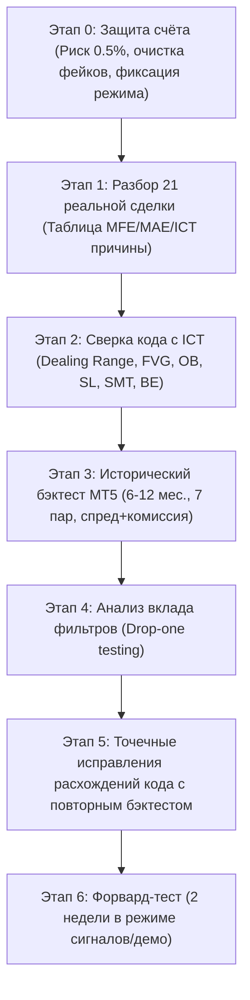

# План реализации: Комплексный аудит, защита капитала и верификация ICT-стратегии

## Goal Description
Цель проекта — провести строгий научный и практический аудит торгового бота Smart Trader Bot на сервере VPS (`[VPS_PROTECTED_IP]`) для проп-челленджа FundingPips $5,000 (Account `[REDACTED_ACCOUNT]`).
Категорический принцип работы: **никаких новых функций, индикаторов или надстроек**. Правила ICT-стратегии остаются неизменными. Проверяются только два фундаментальных вопроса:
1. Точно ли программный код исполняет заявленные правила ICT/SMC?
2. Обладает ли данная стратегия подтвержденным статистическим преимуществом (Edge) на реальных исторических данных брокера?

---

## User Review Required

> [!IMPORTANT]
> **Решение владельца счёта по режиму торговли на время аудита (Этап 0):**
> До полного завершения бэктеста и верификации кода необходимо выбрать один из двух защитных режимов для предотвращения дальнейшей просадки депозита:
> * **Вариант 1 (Рекомендуемый): Режим «Только сигналы» (`autotrade_enabled = false`).** Советник в MT5 не открывает сделок самостоятельно, все сигналы транслируются только в Telegram для ручного контроля.
> * **Вариант 2: Снижение риска до 0.25% ($12.20 на сделку).** Автопилот остаётся включенным, но с минимальным риском (фактический лот ~0.07..0.08).

> [!WARNING]
> **Очистка базы данных от тестовых сделок (Этап 0):**
> В таблице `broker_deals` базы `data/signals.db` обнаружены две синтетические записи:
> * Тикет `778899` (+15.00 USD)
> * Тикет `889901` (+25.00 USD)
> Эти фиктивные сделки завышали статистику на +$40.00. План предусматривает их изоляцию (перевод во вспомогательную таблицу `test_deals`), после чего эндпоинт `/api/stats` будет показывать чистую брокерскую правду: **21 сделка, баланс $4,886.97, чистый убыток -$102.23**.

---

## Open Questions

1. Какой из двух защитных вариантов торговли вы утверждаете на время проведения аудита: **Вариант 1 (Только сигналы)** или **Вариант 2 (Снижение риска до 0.25%)**?
2. Достаточен ли диапазон исторических котировок MT5 для бэктеста в **6 месяцев (M5–D1)**, либо выгрузить максимально доступную глубину истории котировок FundingPips (до 12 месяцев)?

---

## Proposed Changes

План работ разбит на 7 последовательных этапов:



---

### [Компонент 1: Защита капитала и калибровка риска (Этап 0)]

#### [MODIFY] `data/signals.db` (таблица `bot_settings`)
* Обновить параметр `trading_risk` с `1.0` на `0.5`.
* Установить режим авто-торговли в соответствии с выбором пользователя (`enabled = false` или `risk = 0.25`).

#### [MODIFY] `trading/execution_bridge.py`
* В методе `calculate_lot` и `__init__` жестко закрепить `risk_pct = 0.5` (или 0.25).
* Добавить строгую проверку отклонения лота: если вычисленный объем превышает допустимый риск более чем на 5% от депозита, лот принудительно округляется вниз к меньшему шагу объема (`MathFloor`).

#### [MODIFY] `/home/trader/.wine/drive_c/Program Files/MetaTrader 5/MQL5/Experts/SmartTraderBridge.mq5`
* Скорректировать входящий параметр `input double InpRiskPercent = 0.5;` (строка 24).
* Обновить логику получения `json_risk`: если из Python передан риск, советник использует строго его, а не 1.0%.

#### [MODIFY] `/home/trader/.wine/drive_c/Program Files/MetaTrader 5/Profiles/Charts/Default/chart01.chr`
* Обновить параметры советника в шаблоне графика:
  ```ini
  InpRiskPercent=0.5
  InpUseAutoRisk=true
  ```
* Скомпилировать советник через MetaEditor64 без ошибок и предупреждений.

#### [MODIFY] `webapp/server.py` и очистка `broker_deals`
* Изолировать тикеты `778899` и `889901` из выборки реальных сделок.
* Синхронизировать расчет `/api/stats` строго по закрытым тикетам брокера с префиксом `1...` (FundingPips).

---

### [Компонент 2: Аудит 21 сделки брокера (Этап 1)]

#### [NEW] `scripts/audit_21_deals.py`
* Скрипт потикового и свечного сопоставления всех 21 сделок:
  * Извлечение времени открытия и закрытия из MT5 Deals History.
  * Загрузка исторических свечей D1, H4, H1, M15 в момент входа.
  * Определение истинного Dealing Range дня и недели на момент сделки.
  * Расчет максимального движения цены в плюс (**MFE — Maximum Favorable Excursion**) и в минус (**MAE — Maximum Adverse Excursion**).
  * Моделирование альтернативных исходов: был ли взят безубыток при +1.0R или при +9.0 пипсах.
  * Категоризация каждого убытка:
    1. *Ошибка реализации* (неправильный Dealing Range, стоп внутри пула ликвидности).
    2. *Ошибка риска* (превышение лота).
    3. *Рыночный шум / нормальный стоп*.

---

### [Компонент 3: Ревизия кодовой базы ICT (Этап 2)]

#### [MODIFY / AUDIT] `strategies/ict_smc.py`
Провести постраничный аудит строк:
1. **Dealing Range (строки 1164–1198):**
   * *Текущее состояние:* диапазон считается от локальных пивотов последних свечей M15/H1 (ошибка микро-диапазона).
   * *Канон ICT:* Dealing Range определяется между ключевыми HTF свингами (H4/H1 Swing High/Low) или сессионным диапазоном дня (Asian High/Low -> London Expansion).
2. **Стоп-лосс (строки 1260–1320):**
   * Проверить, ставится ли стоп за валидированный Order Block / FVG или бросается в пустоту перед пулом равных лоу/хаев (EQH/EQL).
3. **Логика безубытка в советнике (строки 1105, 1162 `SmartTraderBridge.mq5`):**
   * Устранить баг, когда вместо порога `InpBETriggerPips = 9` советник принудительно требовал прохода дистанции `risk_dist = 16.4 п.`, лишая позицию защиты.
4. **SMT Divergence (строки 569–750):**
   * Проверить факт загрузки котировок DXY: подтягивается ли реальный индекс доллара или оценка идет только по паре EUR/GBP.

---

### [Компонент 4: Инфраструктура бэктеста MT5 (Этап 3 & 4)]

#### [NEW] `scripts/backtest_engine.py`
* Автономный бэктестер на Python, использующий исторические OHLCV котировки MT5 брокера FundingPips:
  * Таймфреймы: M5, M15, H1, H4, D1.
  * Учет реального спреда (включая ночное расширение) и комиссии ($3 за лот).
  * Побарное исполнение: анализ строго на **закрытии** свечи (zero look-ahead bias).
  * Вывод полной статистики: Win Rate, Profit Factor, Expectancy (в R и USD), Max Drawdown, Max Consec Losses.
  * Walk-forward анализ: разделение истории на In-Sample (обучающая, 70%) и Out-of-Sample (проверочная, 30%).

#### [NEW] `scripts/filter_ablation_study.py`
* Исследование вклада каждого фильтра (Drop-One Analysis):
  * Базовый тест: все фильтры включены.
  * Тест без D1 Trend Filter.
  * Тест без 50% Equilibrium Filter.
  * Тест без SMT Divergence.
  * Тест без IPDA Macro Windows.
  * Отчет: какие фильтры реально дают математическое преимущество (+Expectancy), а какие лишь срезают прибыльные входы.

---

### [Компонент 5: Исправления и подготовка к форвард-тесту (Этап 5 & 6)]

* Внесение точечных исправлений в `strategies/ict_smc.py` **исключительно по расхождениям с каноном ICT**, выявленным на Этапе 2.
* Проведение контрольного бэктеста до и после каждого изменения.
* Формирование честного чек-листа допуска к реальному счёту (Критерии: Expectancy > +0.2R, PF > 1.3, DD < 6% на 100+ сделках Out-of-Sample).

---

## Verification Plan

### Automated Tests
1. **Верификация расчета объема лота (Этап 0):**
   ```bash
   /root/smart-trader-bot/venv/bin/python /tmp/test_lot_risk.py
   ```
   *Ожидаемый результат:* При балансе $4,886.97 и SL = 16.4 pips лот строго равен **0.15** (риск $24.43 = 0.499% депозита). Отклонение $\le 5\%$.
2. **Верификация целостности API статистики:**
   ```bash
   curl -s http://127.0.0.1:8080/api/stats
   ```
   *Ожидаемый результат:* 21 закрытая сделка, total_profit_usd = -$102.23 (без фейковых тикетов 778899 и 889901).
3. **Запуск скрипта аудита 21 сделки:**
   ```bash
   /root/smart-trader-bot/venv/bin/python scripts/audit_21_deals.py
   ```
4. **Запуск исторического бэктеста:**
   ```bash
   /root/smart-trader-bot/venv/bin/python scripts/backtest_engine.py --months 6
   ```

### Manual Verification
1. В терминале MT5 проверить вкладку «История торговли»: отсутствие сторонних ордеров, совпадение баланса `$4,886.97`.
2. В окне параметров советника `SmartTraderBridge` на графике MT5 убедиться, что `InpRiskPercent` отображает `0.5%`.
